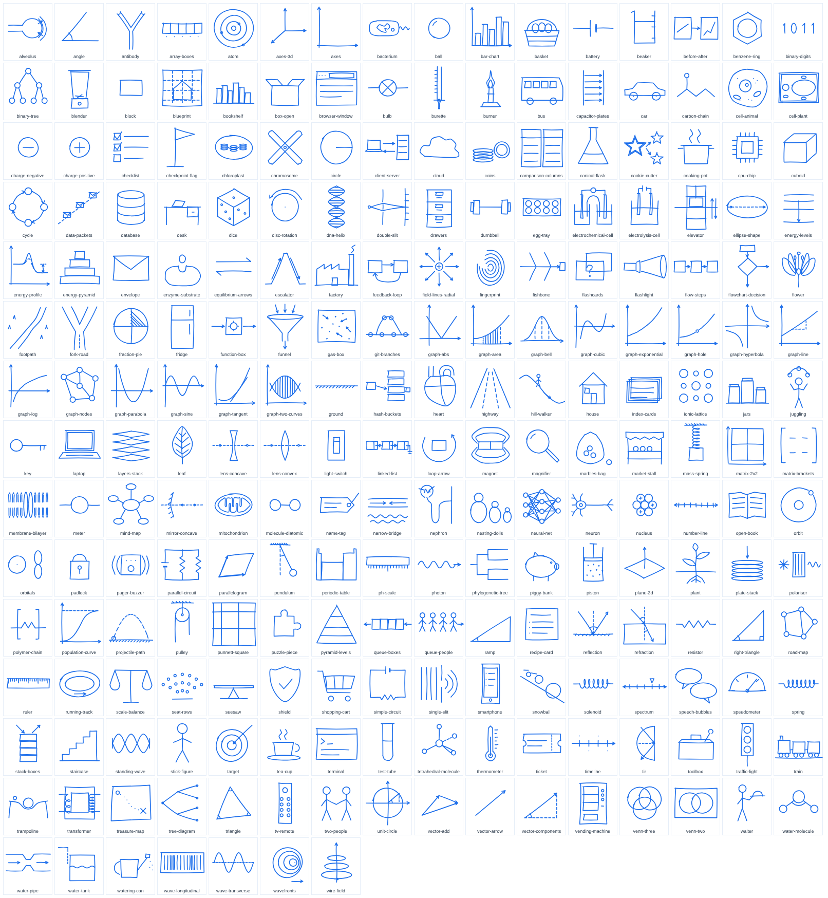

# Nibley study library

A ready-made library so Nibley's cheap runtime model (Haiku) doesn't have to invent things. A smart model worked out the hard parts once: what to teach, in what order, which basics each topic needs, and the drawings. At runtime Haiku looks up a topic, reads its short note, and places ready-made drawings (`draw ramp`, `arrow to block.top`).



## What's in it

| | Foundation | Class 11 | Class 12 | Total |
|---|---|---|---|---|
| Physics topics | 6 | 46 | 30 | 82 |
| Maths topics | 16 | 30 | 28 | 74 |
| Chemistry topics | 2 | 22 | 16 | 40 |
| Biology topics | 2 | 16 | 15 | 33 |
| **All topics** | 26 | 114 | 89 | **229** |

- **229 teaching notes**, one per topic (`notes/<id>.md`).
- **124 drawings** (`assets/*.svg`) in Nibley's pen style: 7 shared, 31 maths, 48 physics, 17 chemistry, 21 biology. Every drawing is used by at least one topic.
- **A prerequisite tree** (`prereqs` in `topics.json`): every topic links down to the basics it needs, ending at foundation topics. No loops. A prerequisite is never at a higher level than the topic.
- `node library/check.js` checks all of it (see below).

## Files

| File | What it is |
|---|---|
| `topics.json` | All topics: `id`, `subject`, `level`, `title`, `summary` (max 20 words), `prereqs`, `assets` |
| `notes/<id>.md` | Teaching note for Haiku, max 400 words, 7 fixed sections |
| `assets/<name>.svg` | One drawing, 200×200, paths only |
| `assets/index.json` | Drawing list: `name`, `subject`, `tags`, `desc`, `anchors` (named points to aim arrows and labels at) |
| `check.js` | Validator, plain Node, no dependencies, no network |
| `syllabus-comparison.md` | Which syllabi were compared and which topic areas made it in |
| `tools/draw.js`, `tools/specs/*.js` | The drawing engine and the drawing recipes (rebuild with `node library/tools/draw.js`) |
| `preview.png` | Picture of every drawing (the image above) |
| `BUILD-LOG.md` | What was done in which order, for resuming |

### Format details the app should know
These follow the brief. Where the brief didn't say, this is what was chosen:
- `subject` in `topics.json` is `physics`, `maths`, `chemistry` or `biology`. Chemistry and biology were added at Zarif's request after the brief was written, so the app must accept those two values.
- A drawing's `subject` can also be `shared` (useful in more than one subject, e.g. `axes`, `ball`).
- SVG style (`fill="none"`, `stroke="currentColor"`, `stroke-width="3.5"`, round caps and joins) sits on the root `<svg>` and the paths inherit it. This keeps files small (largest is 3.7 KB). If the app copies paths out on their own, it must add those attributes. Path order is drawing order.
- Notes start with `# <title>`. In `## Picture it`, drawing names are in backticks (`` `ramp` ``) and anchors as `` `asset.anchor` `` (`` `block.top` ``); `check.js` makes sure every one exists. Labels are in "double quotes", max 6 words.
- `## Check questions`: `1. question` then an indented `   Answer: ...` line, three times.
- `## Flashcards`: five `Q:` / `A:` line pairs.
- `## Root check`: `- <prereq-id>: question Answer: answer`, one line per prereq (`none` for root topics). A wrong answer means that basic is weak (for the gap finder).

## How to check
```
node library/check.js            # full check, exits 1 on any problem
node library/check.js --partial  # while building: missing notes are "pending", not failures
node library/check.js --only a,b # check just the notes for topics a and b
```
It checks: unique kebab-case ids, valid subject/level, summary ≤ 20 words, prereqs exist, prereq level not above the topic, no cycles, roots are foundation topics; every topic has a note with the 7 headings in order, ≤ 400 words, Simple idea ≤ 60 words, 3 mistakes, 3 check questions with answers, 5 flashcards, one root check per prereq; every asset named in a note exists, belongs to that topic and has the named anchor; every referenced asset exists and every drawing is used; every SVG is only `<path>` elements, no text/colour/fill/filter, valid viewBox, ≤ 12 paths, ≤ 4 KB, coordinates inside the box; anchors inside 0..200.

## How it was made
1. **Syllabi compared** (topic lists only, nothing copied): CBSE/NCERT 11-12, Bangladesh HSC, Cambridge AS & A Level, AP, IB Diploma. A topic area is in if at least 3 of the 5 cover it. Details and the table: `syllabus-comparison.md`.
2. **Topic list and prerequisite tree** written by the lead model (Opus), plus `check.js`.
3. **Drawings**: Opus wrote a small pen engine (`tools/draw.js`) that adds the hand-drawn wobble the same way every time, and drew 12 core drawings as the style example. Sonnet workers wrote recipes for the other 112. Opus looked at every drawing on a contact sheet and fixed or redrew 6 (tangent graph, polariser, atom and wavefronts rings, spin arrow, heart).
4. **Notes**: Opus wrote one gold-standard note (`newtons-second-law`). Sonnet workers wrote the rest in 15 batches of 13-17. Each worker ran `check.js` on its batch. Opus then read notes from every batch, and Sonnet fact-checkers read the rest (counts below).
5. **Chemistry and biology** were added mid-session at Zarif's request, after physics and maths were done, with the same steps.

## What was checked, and what was not
- `check.js`: full strict run passes (see the PR for the output).
- Drawings: Opus looked at **all 124**.
- Notes, two passes:
  - **Opus read 45 of 229 notes in full** (3 from each of the 15 batches, the riskiest topics) and wrote 1 (`newtons-second-law`).
  - **Sonnet fact-checkers read the other 183** (redoing every calculation, checking every formula and claim, comparing each picture with its drawing). They only reported problems; Opus checked each report before changing anything.
  - Found and fixed: 4 factual errors (hyperbola "never touches the axes", X-linked "1 in 4 sons", "C–Cl is the most polar" halogen bond, "faster waves travel faster") and 13 misleading or unclear lines (wrong picture labels, ambiguous wording). Added the right-hand grip rule and Fleming's left-hand rule, which a writer had left out.
  - What this means: 183 notes were fact-checked by a cheaper model, not by Opus. With 4 factual errors in 229, a few more may remain. `check.js` checks format, not facts.
- Nobody has tested the library inside the app yet (the app code is being changed in another session).

## Known gaps
- **Syllabus table** comes from the model's knowledge of the published topic lists; it was not re-checked against the 2026 syllabus documents.
- **Topic areas left out** (fewer than 3 of 5 syllabi): semiconductors, special relativity, astrophysics, particle physics, linear programming, mathematical induction, correlation/regression, hypothesis testing, numerical methods, colligative properties, metallurgy, animal behaviour.
- **Meet the rule but not in this version**: plant hormones and tropisms, muscles and movement.
- **Sign conventions differ between syllabi.** Mirror and lens notes use the Cartesian convention (CBSE/HSC style: 1/v − 1/u = 1/f for lenses). The first law of thermodynamics note uses ΔU = Q − W (W done by the gas) and says other books write it differently.
- **Facts the writers left out on purpose** because they weren't sure or syllabi differ: pV = ⅓Nm⟨c²⟩ and rms speed (kinetic theory), standing waves in pipes, an exact ATP yield per glucose. Speed of sound is given as "about 340 m/s".
- **No drawing**: `factorising` and `dimensional-analysis` have no asset; their notes describe what to write instead.
- **Weaker drawings**: `membrane-bilayer` (heads are tiny dots), `flower` (busy), `nephron` and `heart` (simplified schematics), `periodic-table` (block outline only, rough proportions). Some anchors (heart chambers, pyramid levels) sit in the middle of a shape, not on a line.
- **Levels** (`11` vs `12`) follow the most common placement; some syllabi teach a topic a year earlier or later.

## Changes from the brief
- Branch: the brief asked for `library-v1`; this cloud session can only push to `claude/sleepy-darwin-jy0kpp`, so the work and PR are on that branch.
- Build log is `library/BUILD-LOG.md`, because the brief says not to edit `docs/`.
- Chemistry and biology added (Zarif's request).
- Extra files beyond the contract: `tools/` (drawing engine and recipes), `preview.png`, `syllabus-comparison.md`, `BUILD-LOG.md`. `check.js` has `--partial` and `--only` options for building in steps.
- The 10 physics/maths note batches finished at almost the same time, so they went in one commit instead of ten.

## Analogies and everyday drawings (added 2026-11-04, any topic)
- `analogies.json`: 107 analogies (computing 57, maths 15, physics 9, chemistry 5, biology 8, economics 7, learning 6). Fields: `id, domain, concept, keywords, analogy, mapping` (2-4 familiar → target pairs), `breaks` (where it fails, said once), `assets`, optional `topic` (33 link to topics.json) and `source`.
- 107 new drawings: `tools/specs/50-everyday.js` (70 everyday objects), `60-computing.js` (21), `70-diagrams.js` (16 templates). Same pen engine and rules. Checked on contact sheets; 4 redrawn (watering can, queue arrow, layer stack twice).
- `check.js` validates analogies (fields, word limits, assets, topics) and counts analogy use, so a drawing only needs a topic *or* an analogy. Diagram templates are exempt.
- Research: `research/2026-11-04-analogies-for-any-topic.md`. Runtime lookup: `src/learn/analogies.js`.

## Programming subject (added 2026-11-04)
- 24 topics with `subject: computing` and full notes, from "What a program is" to recursion, Big O, classes, trees and graphs, the web and Git. Levels reuse the library's scale: `foundation` = first programs, `11` = core skills, `12` = data structures and systems.
- The tree links into maths where it's real: operators need `arithmetic-basics`, Big O needs `logarithms`.
- Variables are taught as name tags, not boxes (Hermans et al. 2018; see `research/2026-11-04-analogies-for-any-topic.md`).
- 36 coding analogies now point at these topics (`topic`), so the analogy lookup finds them by topic as well as by words.
